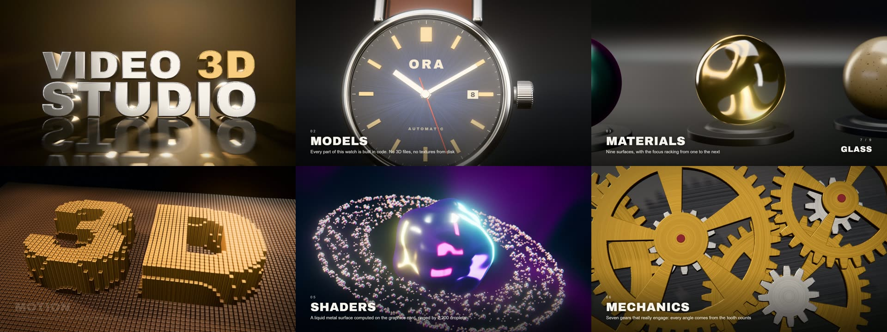
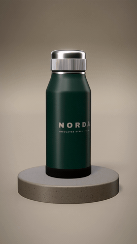
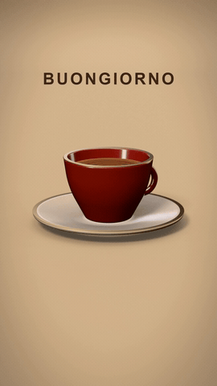
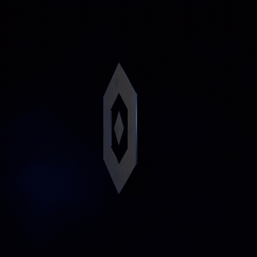
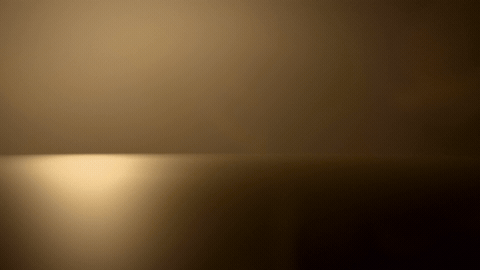
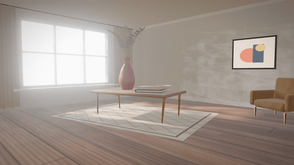
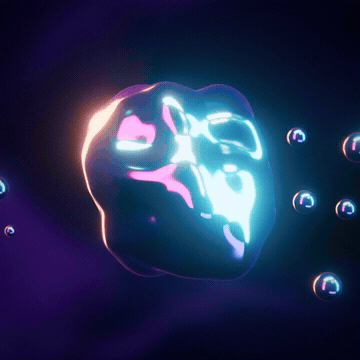

<div align="center">

# Video 3D Studio

**Descrivi un'inquadratura. Ottieni un video 3D.**

Una skill gratuita e open source per [Claude Code](https://claude.com/claude-code) che scrive scene 3D come codice,<br>
controlla il proprio lavoro e renderizza video MP4 sul tuo computer.

[English](README.md)

<a href="https://github.com/OnlyG4BB0/video-3d-studio/releases/download/v1.2.0/film-16x9.mp4"></a>

**[Scarica il film dimostrativo di 90 secondi](https://github.com/OnlyG4BB0/video-3d-studio/releases/download/v1.2.0/film-16x9.mp4)**<br>
<sub>Otto capitoli realizzati da zero con questa skill. MP4 1080p con colonna sonora originale, 181 MB.</sub>

<table>
<tr>
<td align="center"><br><sub>Prodotto</sub></td>
<td align="center"><br><sub>Scena creata su richiesta</sub></td>
<td align="center"><br><sub>Logo animato</sub></td>
</tr>
</table>
<table>
<tr>
<td align="center"><br><sub>Titolo 3D</sub></td>
<td align="center"><br><sub>Ambiente</sub></td>
</tr>
</table>
<table>
<tr>
<td align="center"><br><sub>Shader liquido</sub></td>
</tr>
</table>

<sub>Anteprime compresse. I video MP4 in alta qualità sono allegati all'<a href="https://github.com/OnlyG4BB0/video-3d-studio/releases/latest">ultima release</a>.</sub>

</div>

## Cosa sa fare

- **Video di prodotto.** La camera gira attorno a un oggetto costruito con il codice, oppure al tuo modello `.glb`.
- **Loghi animati in 3D.** Da un file `.svg` crea un logo solido, lo illumina e lo anima, con uno slogan opzionale.
- **Titoli 3D.** Lettere solide animate una a una, con il font incluso o con il tuo `.ttf` / `.otf`, accenti compresi.
- **Stanze e atmosfere.** Sole che entra dalla finestra, ombre di foglie in movimento, raggi di luce nell'aria.
- **Pezzi astratti con shader.** Metallo liquido, superfici iridescenti, sfondi di colore in movimento.
- **Scene su misura.** Chiedi qualcosa di nuovo e Claude lo modella con i pezzi del kit.
- **Film a capitoli.** Unisci qualsiasi scena in un film più lungo con le dissolvenze. Include un esempio completo di 90 secondi.
- **Musica originale.** Una colonna sonora sintetizzata da zero, senza campioni, sincronizzata con quello che succede sullo schermo.
- **Tutti i formati social.** 9:16, 16:9 e 1:1 dalla stessa scena, con un'inquadratura che si adatta.
- **Modifiche a parole.** "Luce più calda" o "camera più lenta" cambiano solo quello.

### 64 passaggi per ogni fotogramma

Ogni fotogramma viene disegnato 64 volte con piccole variazioni e poi mediato. La luce si sposta, l'obiettivo si sposta, i pixel si muovono di una frazione. Da questa sola tecnica nascono:

- **Ombre morbide**, nitide nel punto di contatto e sfumate con la distanza
- **Occlusione del cielo**, il naturale scurirsi di angoli e zone sotto gli oggetti
- **Sfocatura vera dell'obiettivo**, non un'imitazione applicata dopo
- **Riflessi lucidi**, netti sul pavimento e sempre più sfumati verso l'alto
- **Raggi volumetrici** uniformi, senza bande visibili

### Controlla il proprio lavoro

Prima del render finale, Claude guarda alcuni fotogrammi della scena e poi uno strumento analizza **tutti i fotogrammi** alla ricerca di lampi e salti improvvisi. Questo controllo esiste per un problema reale: durante lo sviluppo, un logo diventava bianco per pochi fotogrammi che i campioni non avevano mostrato.

### Tutto sul tuo computer

Niente abbonamenti, crediti di render o caricamenti. Luci e materiali sono generati dal codice, quindi il render non dipende da file esterni. Internet serve solo per l'installazione e per il browser che Remotion scarica la prima volta.

## Installazione

Servono [Claude Code](https://claude.com/claude-code) e [Node.js](https://nodejs.org) 18 o più recente. Una scheda grafica aiuta, ma non è obbligatoria.

**macOS / Linux**

```bash
git clone https://github.com/OnlyG4BB0/video-3d-studio.git ~/.claude/skills/video-3d-studio
```

**Windows (PowerShell)**

```powershell
git clone https://github.com/OnlyG4BB0/video-3d-studio.git "$HOME\.claude\skills\video-3d-studio"
```

Poi apri una nuova sessione di Claude Code. Oppure incolla questa frase in Claude Code e lascia fare a lui:

```text
Installa la skill da https://github.com/OnlyG4BB0/video-3d-studio nella cartella delle mie skill personali di Claude Code.
```

## Come si usa

Basta descrivere il video:

```text
Fammi un video 3D verticale di 6 secondi di una borraccia verde su un piedistallo di pietra, luce calda da studio.
```

```text
Crea un'animazione 3D orizzontale di 5 secondi con la parola MILANO in lettere dorate.
```

```text
Anima il mio logo in 3D: il file è logo.svg, sfondo nero e la scritta "Dal 1985" sotto.
```

```text
Usa il mio modello prodotto.glb per un video quadrato di 8 secondi con la camera che gira attorno.
```

```text
Una stanza luminosa al mattino con ombre di foglie sul pavimento, 16:9, 8 secondi.
```

```text
Un film di 40 secondi sul mio marchio di caffè in quattro capitoli, con musica: titolo, la tazzina, la torrefazione, logo.
```

Se la skill non parte da sola, aggiungi "usa la skill video-3d-studio" alla richiesta.

## Comandi dentro un progetto

| Comando | A cosa serve |
|---|---|
| `node tools/stills.mjs Shot --count 5` | Fotogrammi di controllo |
| `node tools/check-motion.mjs Shot` | Analisi di tutti i fotogrammi per lampi e salti |
| `node tools/render.mjs Shot --out out/nome.mp4` | MP4 finale |
| `node tools/render.mjs Film --music` | Il film, con la sua musica originale |
| `node tools/music.mjs Shot --mood warm` | Solo la musica, in WAV |
| `node tools/stills.mjs Film --dissolves` | Il centro di ogni dissolvenza |
| `npm run studio` | Anteprima dal vivo nel browser |

Ogni impostazione si può cambiare con `--set`, ad esempio `--set format=vertical --set "text=CIAO"`.

## Da sapere

**Provata su** Windows 11 con RTX 3060 e Node.js 23.2, dove video da 5 a 8 secondi hanno richiesto da 36 a 88 secondi alla massima qualità e il film dimostrativo di 90 secondi da 16 a 23 minuti. Dovrebbe funzionare anche su macOS e Linux, ma non è ancora stata provata: le segnalazioni sono benvenute. Senza scheda grafica passa a 4 passaggi per fotogramma, con un risultato più grezzo e tempi molto più lunghi.

**Spazio su disco.** Ogni progetto occupa circa 1 GB e il primo render di ogni progetto scarica un browser da 130 MB.

**Musica.** La colonna sonora segue regole semplici e viene controllata misurandone i livelli, perché Claude non può ascoltarla. Considerala un sottofondo e ascoltala prima di pubblicare.

**Limiti attuali**

- Non c'è un vero motion blur, quindi i movimenti molto veloci possono sembrare a scatti.
- L'illuminazione non è un ray tracing completo. La luce non rimbalza da sola, quindi gli interni sono le scene meno fotorealistiche.
- I loghi SVG devono usare forme piene, quindi i contorni vanno convertiti in tracciati.

## Licenze

Il codice e i testi di questa repository sono rilasciati con licenza [MIT](LICENSE).

**Remotion ha una licenza propria.** È gratuito per i privati, le organizzazioni non profit e le aziende fino a 3 persone. Le aziende più grandi devono acquistare una [licenza aziendale](https://www.remotion.dev/license).

Il font Archivo Black incluso è distribuito con licenza [SIL Open Font License](starter/public/fonts/ArchivoBlack-OFL.txt).

Questo è un progetto indipendente, non affiliato né approvato da Anthropic, Remotion o three.js.
