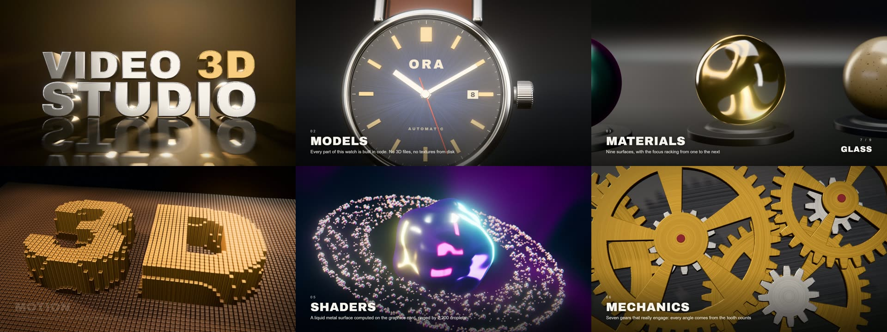
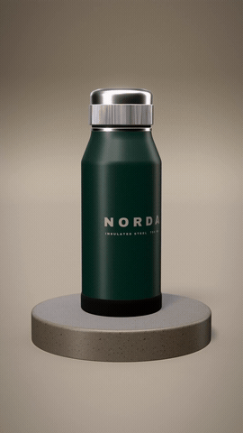
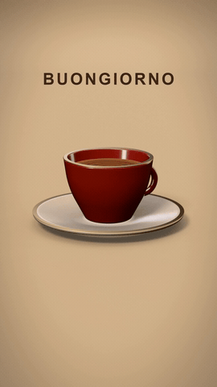
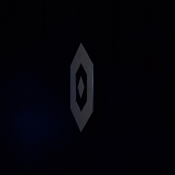
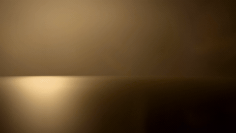
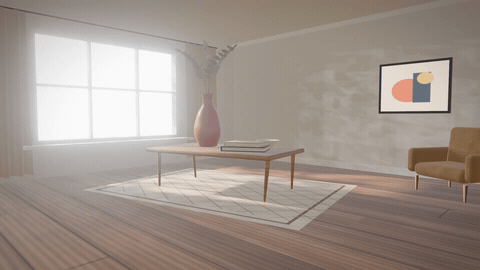
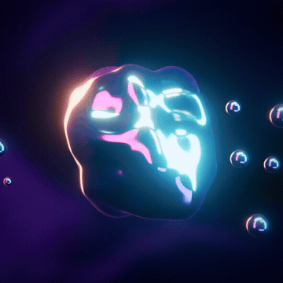
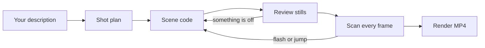

<div align="center">

# Video 3D Studio

**Describe a shot. Get a rendered 3D video.**

A free, open-source [Claude Code](https://claude.com/claude-code) skill that writes 3D scenes as code,<br>
checks its own work, and renders MP4 clips on your computer.

[](LICENSE)


[Italiano](README.it.md)

<a href="https://github.com/OnlyG4BB0/video-3d-studio/releases/download/v1.2.0/film-16x9.mp4"></a>

**[Download the 90-second demo film](https://github.com/OnlyG4BB0/video-3d-studio/releases/download/v1.2.0/film-16x9.mp4)**<br>
<sub>Eight chapters made from scratch with this skill. 1080p MP4 with an original soundtrack, 181 MB.</sub>

<table>
<tr>
<td align="center"><br><sub>Product orbit</sub></td>
<td align="center"><br><sub>Custom scene from a brief</sub></td>
<td align="center"><br><sub>Logo reveal</sub></td>
</tr>
</table>
<table>
<tr>
<td align="center"><br><sub>Kinetic title</sub></td>
<td align="center"><br><sub>Interior</sub></td>
</tr>
</table>
<table>
<tr>
<td align="center"><br><sub>Liquid shader</sub></td>
</tr>
</table>

<sub>Compressed previews. Full-quality MP4s are attached to the <a href="https://github.com/OnlyG4BB0/video-3d-studio/releases/latest">latest release</a>.</sub>

</div>

## What it can do

- **Product shots.** Orbit around an object built in code, or drop in your own `.glb` model.
- **3D logo reveals.** Give it an `.svg` and it extrudes, lights and animates it, with an optional tagline.
- **Kinetic titles.** Solid letters animated one by one, in the built-in font or your own `.ttf` / `.otf`, with accented characters.
- **Rooms and atmospheres.** Sunlight through a window, moving leaf shadows, shafts of light in the air.
- **Abstract shader pieces.** Liquid metal, iridescent surfaces, drifting colour backdrops.
- **Custom scenes.** Ask for something new and Claude models it from the kit's building blocks.
- **Films with chapters.** Join any scenes into a longer film with dissolves. A complete 90-second example is included.
- **Original music.** A soundtrack synthesised from scratch, with no samples, timed to what happens on screen.
- **Every social format.** 9:16, 16:9 and 1:1 from the same scene, with framing that adapts.
- **Notes in plain language.** "Warmer light" or "slower camera" changes that one thing.

### 64 passes per frame

Each video frame is drawn 64 times with small variations and averaged. The light moves, the lens moves, the pixels shift by a fraction. That single technique produces:

- **Soft shadows** that stay sharp at the point of contact and melt with distance
- **Sky occlusion**, the natural darkening in corners and under objects
- **Real lens blur** rather than a post-processing imitation
- **Glossy reflections** that are crisp at the floor and dissolve above it
- **Volumetric beams** that come out smooth, without banding

### It checks its own work

Before the final render, Claude looks at still frames of the shot, then a tool scans **every frame** for flashes and sudden jumps. That scan exists because of a real bug: while this kit was being built, a logo flashed white for a few frames that the sampled stills had missed.

### Everything runs on your machine

There are no subscriptions, render credits or uploads. Lights and materials are generated in code, so a render does not depend on external assets. You need internet only to install it, and for the browser Remotion downloads the first time.

## Install

You need [Claude Code](https://claude.com/claude-code) and [Node.js](https://nodejs.org) 18 or newer. A graphics card helps but is not required.

**macOS / Linux**

```bash
git clone https://github.com/OnlyG4BB0/video-3d-studio.git ~/.claude/skills/video-3d-studio
```

**Windows (PowerShell)**

```powershell
git clone https://github.com/OnlyG4BB0/video-3d-studio.git "$HOME\.claude\skills\video-3d-studio"
```

Then open a new Claude Code session. Or paste this into Claude Code and let it do the work:

```text
Install the skill from https://github.com/OnlyG4BB0/video-3d-studio into my personal Claude Code skills folder.
```

## Use it

Just describe what you want:

```text
Make a 6-second vertical 3D video of a green flask on a stone plinth, warm studio light.
```

```text
5-second 16:9 title animation: the word MILANO in gold 3D letters.
```

```text
Animate my logo in 3D. The file is logo.svg, black background, "Since 1985" underneath.
```

```text
Use my product.glb for an 8-second square video with the camera circling it.
```

```text
A bright room in the morning with leaf shadows on the floor, 16:9, 8 seconds.
```

```text
A 40-second film about my coffee brand in four chapters, with music: title, the cup, the roastery, logo.
```

If the skill does not start on its own, add "use the video-3d-studio skill" to your request.

## How it works



Each shot is a [Remotion](https://www.remotion.dev) composition built with [three.js](https://threejs.org). The kit provides:

| Part | What it gives you |
|---|---|
| Camera | Real lens sizes, orbit and path moves, subtle handheld drift, framing that fits any format |
| Light | Sun with real softness, occluded sky light, volumetric beams, six procedural environments |
| Materials | Chrome, brushed metal, gold, anodized, powder coat, car paint, gloss plastic, ceramic, pearl, oil slick, liquid chrome, rubber, velvet, stone, plaster, glass |
| Surfaces | Procedural timber, scratches, brushing, grip ridges, woven cloth, terrazzo, printed labels |
| Shaders | Rippling liquid material with correct shadows, drifting aurora backdrop |
| Geometry | Revolved shapes with rounded corners, soft boxes, smooth bevels, seamless studio backdrops |
| Files | SVG extrusion, TTF/OTF letters, GLB models |
| Motion | Springs, easing, staggering, repeatable noise for renders that come out the same every time |
| Finish | Tone mapping, bloom, lens blur, contrast and colour grade, colour fringing, vignette, film grain |
| Films | Chapters with dissolves, each scene reusable as a chapter, captions that adapt to the format |
| Music | Eight moods, sounds placed at exact moments, levels mixed for social and streaming apps |

Claude reads the [workflow](SKILL.md), the [toolkit reference](references/toolkit.md) and the [notes on lens, light and timing](references/craft.md) as it needs them.

### Commands inside a project

| Command | Purpose |
|---|---|
| `node tools/stills.mjs Shot --count 5` | Review images |
| `node tools/check-motion.mjs Shot` | Scan every frame for flashes and jumps |
| `node tools/render.mjs Shot --out out/name.mp4` | Final MP4 |
| `node tools/render.mjs Film --music` | The film, with its original music |
| `node tools/music.mjs Shot --mood warm` | Only the music, as a WAV |
| `node tools/stills.mjs Film --dissolves` | The middle of every dissolve |
| `npm run studio` | Live preview in the browser |

Any setting can be changed with `--set`, for example `--set format=vertical --set "text=HELLO"`.

## Good to know

**Tested on** Windows 11 with an RTX 3060 and Node.js 23.2, where clips of 5 to 8 seconds rendered in 36 to 88 seconds at full quality and the 90-second demo film took 16 to 23 minutes. macOS and Linux should work but have not been tested yet, so reports are welcome. Without a graphics card it falls back to 4 passes per frame, which looks rougher and takes much longer.

**Disk space.** Each project takes about 1 GB, and the first render in each project downloads a 130 MB headless browser.

**Music.** The soundtrack follows simple rules and is checked by measuring its levels, because Claude cannot hear it. Treat it as a background track and listen before you publish.

**Current limits**

- There is no true motion blur, so very fast moves can look stepped.
- Lighting is not full ray tracing. Light does not bounce by itself, so interiors are the least photorealistic scenes.
- SVG logos need filled shapes, so strokes must be converted to outlines first.

## Licences

The code and text in this repository are [MIT](LICENSE) licensed.

**Remotion has its own licence.** It is free for individuals, non-profits and companies of up to 3 people. Larger companies need a [company licence](https://www.remotion.dev/license).

The bundled Archivo Black font is under the [SIL Open Font License](starter/public/fonts/ArchivoBlack-OFL.txt).

This is an independent project, not affiliated with or endorsed by Anthropic, Remotion or three.js.
